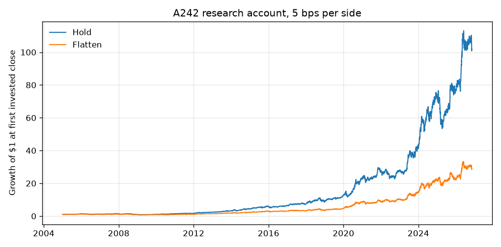
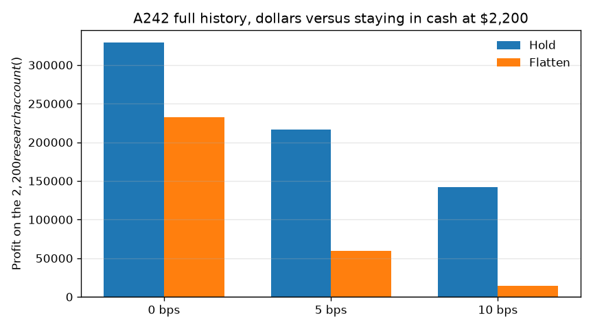
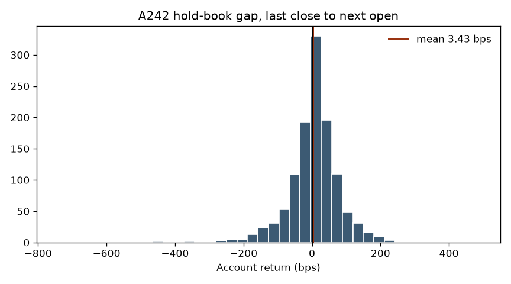

# A242: hold through the weekend or flatten?

Research only. The sanitized AlpacaLive-A242 snapshot was read locally. No orders, no keys, no broker, and no change to live code. Plan `sizing_equity` is not used as account equity.

## Verdict

Do not sell the A242 book before the weekend as a standing rule.

On a research account that starts at **$2,200** in January 2005 and compounds the way A242 sizes, flattening at the last close and buying the same book at the next open finishes **behind**:

| Cost per side | Hold ends at | Flatten ends at | Flatten minus hold |
| ---: | ---: | ---: | ---: |
| 0 bps | $331,183 | $234,897 | **−$96,286** |
| 5 bps | $218,615 | $61,681 | **−$156,934** |
| 10 bps | $144,473 | $16,194 | **−$128,279** |

Those are compounded dollars, not a $96,000 loss on an account that is still $2,200. The account grows, so a small positive gap becomes a large dollar gap. The average gap itself is **+3.43 bps** of account equity (1,192 completed gaps, median +5.71 bps, 40.9% negative, t-stat +1.36). At the starting $2,200 and the book's typical ~0.88 gross weight, that average is well under a dollar a weekend. A 5 bps-per-side round trip is about 9 bps of a fully invested account, several times the average gap.

The live shares we can actually see tell a smaller story. Three Friday-evening snapshots, using the observed `current_qty` and raw prints:

| Weekend | Held into the gap | Gap P&L | On the gross |
| --- | --- | ---: | ---: |
| Fri 2026-10-23 → Mon 2026-10-26 | AMD, CSCO, MRK, XOM | +$6.73 | +31 bps |
| Fri 2026-10-30 → Mon 2026-11-02 | AMD, MRK, XOM | −$14.66 | −86 bps |
| Fri 2026-11-06 → Mon 2026-11-09 open | AMD, CVX, MRK, XOM | +$3.41 | +17 bps |
| Three weekends |  | **−$4.52** |  |

Flattening those three weekends at **0 bps** would have saved **$4.52**. At **5 bps per side** the round trip costs **$5.92**, so flattening finishes **$1.40 behind** holding. At **10 bps per side** it finishes **$7.32 behind**. The SEC/FINRA fee on those three sales is **$0.12** and does not change the ranking.

The only verified account marks are **$2,270.23** at the 2026-10-08 close and **$2,177.44** on 2026-11-09, a decline of **$92.79**. The three observed gaps are $4.52 of that decline. They are not the account's loss. Yahoo had not published a 2026-11-09 close when this was run; the Nov 6 gap uses the Nov 9 **open** (AMD 473.39, CVX 210.85, MRK 148.37, XOM 163.82).

## What A242 actually is

The sanitized CLI, on top of git `09b6fe0`, adds `--strategy a242`:

- 4 longs, shorts excluded (`short_count=0` and every universe name passed in `exclude_from_shorts`, because `short_count=0` alone still opens one short)
- Momentum from 252 sessions ago to 3 sessions ago
- 20-day volatility, inverse-vol weights, 40% name cap, 30% portfolio vol target
- Config gross is 1.90, but `calculate_targets` gives each side half of that. With no short side, the long budget is **0.95**, then vol-scaled down only if trailing vol is above 30%

The 2026-11-06 evening plan matches that signal within 0.1 percentage point per name (AMD 9.02% vs 9.02%, CVX 32.42% vs 32.50%, MRK 25.38% vs 25.38%, XOM 28.18% vs 28.09%). The weights sum to 0.95, not 1.90. `starting_capital=1e9` in the CLI only disables the $220 short-price cap. It is not the account size. Live sizing is broker equity. This study never reads `sizing_equity` as that equity.

Prices in production are Alpaca daily bars, `Adjustment.ALL`, about 400 calendar days, IEX feed. Orders are continuous: market DAY orders while the cash session is open. Until the 2026-11-01 gate, the runner could also send extended-hours limits when the session was closed; 132 submits are in the event log, including after-close limits in late October. From Nov 1, submits wait for regular hours. Nothing in the runner flattens for the weekend. Nov 6 submits were market orders at 12:50, 13:07, 13:35, 14:16, and 15:01 ET.

The archive's plans start **2026-10-20 03:15 ET**. Events start **2026-10-18 13:34 ET**. The 2026-10-10 runner backup still called `--strategy a73`. There is no A242 plan for the verified 2026-10-08 close.

## Long history

Yahoo daily bars, 2004-01-02 through the 2026-11-06 close, with the 2026-11-09 open added where the close was still missing. Signals use the same open/close dividend-and-split factor, rescaled so the decision price is that day's tradeable close. The first book is 2005-01-04, the first session with 252 sessions of history. The static 30-name universe is today's list, so the level of wealth is a survivor's book. Both policies use that same book. The comparison is the gap and the extra round trip, not a claim that $2,200 became $331,000 in a live account.

Signal at the close, trade at the next open. Drift below `max($5, 2% of the position)` is not traded. A name the signal fully closes cannot be reopened for 3 weekdays. The mechanical weekend round trip is not treated as that cool-down. The two-poll intraday confirmation in the runner is inside one daily bar and is not a separate rule. Cash interest is zero. There are no shorts, so there is no borrow. Maximum drawdown stays about **−50%** either way at 0 bps (−49.9% hold, −48.9% flatten) and gets worse once the round trip is charged (−52.0% flatten at 5 bps). Sharpe, zero cash rate, is 1.15 hold vs 1.11 flatten at 0 bps, and 1.06 vs 0.83 at 5 bps.

The holdout from 2023-01-03 through 2026-10-07 has the same sign: the gap averaged **+6.20 bps** (196 gaps, 43.4% negative, t-stat +0.81). No weekday knob was fitted.

At 5 bps per side the long path pays $14,598 of spread if held and $16,859 if flattened. Adding the disclosed SEC/FINRA schedule (with the pre-2024 rates labeled as estimates in the earlier note) changes ending equity from $218,615 to $217,398 if held and from $61,681 to $60,453 if flattened. Fees are not the result.







The left tail is real. The worst reconstructed gap was about **−7.4%** of the account. Oct 30, 2026, on the actual shares, was **−$14.66**. Flattening is insurance against that open. Across this history the insurance was not paid for by the average gap, and at 5 bps per side it was expensive.

## Live shares, not the research account

`current_qty` in the evening plan is the observed holding. On 2026-10-30 the target still wanted CSCO (weight 22.6%) but `current_qty` was 0, so CSCO was not in the weekend mark. The gap dollars above are the shares that were on the book.

A sale a few minutes before the official close is not separately priced. The 0/5/10 bps band is that uncertainty. The Nov 9 equity of $2,177.44 includes Monday's session after the open; this study stops the Nov 6 gap at the open because that is the print Yahoo had.

## Reproduce

```bash
python3 -m pytest tests/test_a242_weekend.py
python3 research/a242_weekend_study.py
```

The second command reuses `research/a242_weekend_output/` and, when the sanitized tar is present, rebuilds the plan snapshots. It does not call Alpaca.
