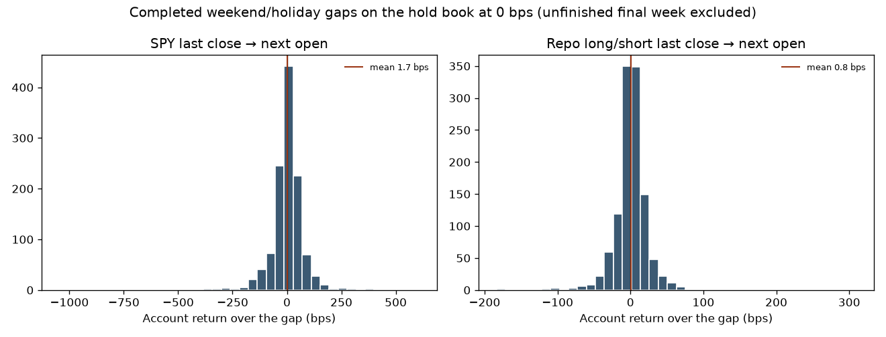
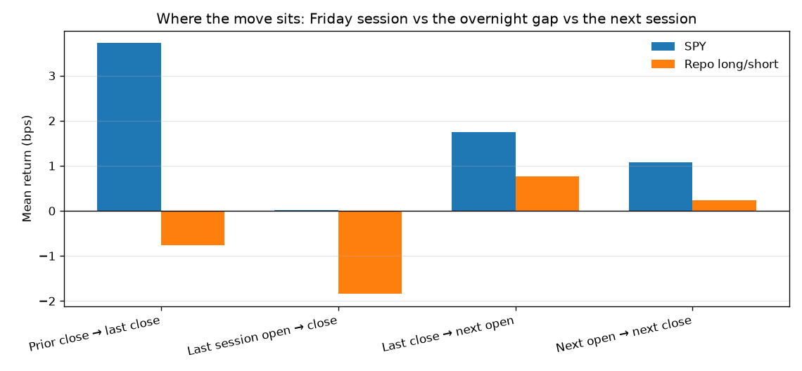
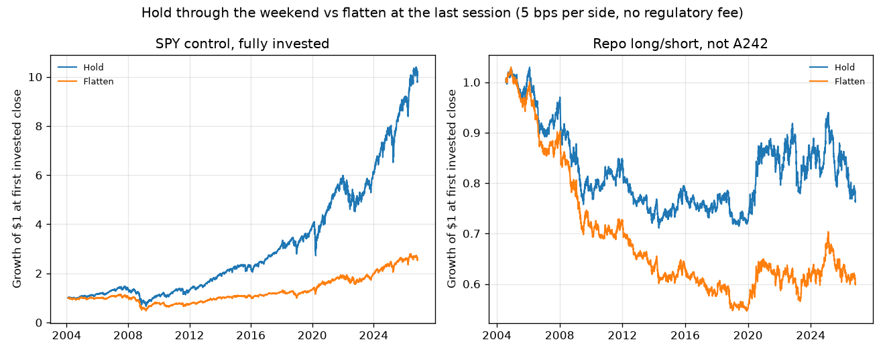
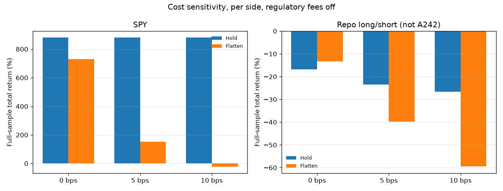

# Weekend hold versus flatten

Research only. No orders, no broker connection, no account keys, and no change to strategy configuration.

## Verdict

Selling before the weekend is not supported for the book this repository can actually reconstruct.

US cash equities have no regular weekend session. The trade the question describes is a sale at the last regular-session close of the week and a buy at the next regular-session open. On the causal long/short book in this repo, that Friday-close to next-open gap averaged **+0.77 bps of account equity** across 1,162 completed gaps (median +1.44 bps, 45.8% negative, t-stat versus zero +1.08). The average gap was a small gain. A round trip at 5 bps per side costs about **5.7 bps of account equity** per weekend at this book's average gross weight of 0.57, and 10 bps per side costs about 11 bps. Those costs are several times the average gap.

The same comparison on SPY, a fully invested control, has the same sign. The gap averaged **+1.74 bps** (1,188 gaps, median +3.46 bps, 45.5% negative, t-stat +0.72). Flattening SPY at 5 bps per side cut ending equity from $21,584 to $5,583 on a $2,200 start. Maximum drawdown did not improve in a way that paid for that.

This is **not an A242 result**. A242 is not in this repository. The numbers above are the in-repo long/short engine and a SPY control. They should not be quoted as the champion book's weekend P&L.

## A242 is not in this repo

| Item | What is actually here |
| --- | --- |
| Repository | `ctemkar/ChatGptWallStreetAITrader`, strategy package `wallstreet-ls` 0.1.0 |
| Strategy commit measured | `09b6fe01318226e37dff141422a4b669d7f9108d` (unchanged on this branch) |
| Live entry point in this repo | `python -m wallstreet_ls.cli --strategy long-short` |
| Signal | `calculate_targets`: 12-1 month momentum (126 days, skip 21), inverse-volatility weights, 5 long / 5 short, 60% gross cap, 10% name cap, 12% vol target |
| Sizing | `build_trade_plan` sizes off `min(equity, $2,200)` and forces short quantities to whole shares. A short is skipped when one share exceeds 10% of $2,200, i.e. a tradeable price above **$220** |
| Claimed live book | Last-known holdings AMD, CVX, MRK, XOM. Those four names are a snapshot, not the historical basket |

The causal book on the last month-end the study was allowed to trade, **2026-10-30**, was:

| Side | Name | Target weight | Tradeable close |
| --- | --- | ---: | ---: |
| Long | MSFT | 8.7% | 521.91 |
| Long | ABBV | 8.4% | 294.89 |
| Long | CRM | 5.1% | 229.17 |
| Long | MRK | 5.1% | 149.52 |
| Long | AMD | 2.6% | 504.80 |
| Short | WMT | 8.7% | 123.51 |
| Short | PEP | 6.8% | 137.34 |
| Short | PG | 6.8% | 161.57 |
| Short | NFLX | 5.2% | 62.08 |
| Short | ORCL | 2.5% | 130.67 |

Gross 60%, net about zero. AMD and MRK overlap the snapshot. CVX ($212.61) and XOM ($165.87) were eligible shorts on price and were not selected. AMD at $504.80 cannot be shorted under the $220 cap; it is a small long because it is volatile. On 2026-11-06, 13 of 30 universe names were at or under $220.

There is no point-in-time A242 weight file, position ledger, or order log in the repo. Inventing that baseline would be a different strategy. The artifact to request is listed at the end.

## What was run

Signals are the real `calculate_targets`, called only with prices through that session. Each window is rescaled so the last close equals that day's tradeable close. Future split and dividend factors therefore cancel in the momentum ratio and do not leak into the $220 cap. A unit test locks that cap: a name whose adjusted history sits under $220 but whose tradeable price is $400 is not shorted.

Marks use one adjustment factor on open and close: `adjusted open = raw open × adjusted close / raw close`. A holder of SPY across the 2004-11-12 to 2004-11-15 ex-dividend window saw a raw close-to-close move of -5.1 bps and an adjusted move of +24.6 bps. The study uses the adjusted move, so a dividend is not counted as a weekend loss. Splits are in the same factor. Ffill of up to three sessions was enabled and filled **zero** cells.

The session calendar is SPY's own trading days, checked against full closures (Good Friday 2024-03-29 and 2025-04-18, Thanksgiving week 2025 ending Friday 2025-11-28, Independence Day observed 2026-07-03). The last session of a holiday week is Thursday when Friday is closed. The sample ends on Friday 2026-11-06, which is a week-end with no following open in the data, so that unfinished Nov 7–9 gap is not scored and neither policy is flattened into it.

| Policy | Execution |
| --- | --- |
| Hold | Month-end signal trades at that session's official close. Shares stay fixed until the next month-end. Every overnight gap is marked, including three-day weekends. |
| Flatten | On the last session of the week, sell at that close. Buy the same target weights at the next session's open, sized off equity at the open. A month-end that is also the week's last session waits for the next open instead of trading twice on Friday. |

Costs are 0, 5, and 10 bps **per side** versus the official print. There is no NBBO in the file, so selling a few minutes before the close is not a separate series; it sits inside that bps band. Alpaca's US equity commission is taken as zero. Cash earns zero interest. Shorts pay zero borrow. Both omissions are small next to 10 bps of round-trip cost on this near-neutral book (average net weight **+2.8%**, average gross **56.7%**). Interest would matter more for a book that is fully long: three days at a 5% rate is about 4 bps, which still does not cover a 10 bps round trip.

Windows were fixed before the run. Nothing was tuned on them.

- Long sample: first invested close (long/short 2004-07-30, SPY 2004-01-30) through 2026-11-06.
- Pre-holdout: through 2022-12-31, shown so the holdout is not the only history.
- Holdout: 2023-01-01 through 2026-10-07 (944 sessions).
- Live window: 2026-10-08 through 2026-11-06 (22 sessions, 4 completed gaps). Sharpe is not reported here; 22 sessions is too short to annualize.

Data: Yahoo Finance chart API v8, daily bars, `includeAdjustedClose=true`, downloaded 2026-11-08T02:37:57Z. Requested range 2004-01-01 through 2026-11-09. **Last bar is 2026-11-06.** This study does not cover Sunday 2026-11-08 and does not cover the open of Monday 2026-11-09.

The static 30-name universe is today's list. That is survivorship bias in the level of returns. It does not by itself create the gap comparison, which uses the same names on both sides. The long/short account lost money over the long sample. That loss is a property of this backtest (survivorship, the $220 short cap, no borrow model). It is not a statement about the live account.

## Where the P&L sits

Hold-book gaps at 0 bps. "Last close → next open" is the weekend or holiday gap. "Last session open → close" is the regular session on the week's last day. Flattening at the close leaves that session in the account.

| Book | Window | Gaps | Mean gap | Median | % negative | t vs 0 | Worst | Best |
| --- | --- | ---: | ---: | ---: | ---: | ---: | ---: | ---: |
| Repo long/short | Full | 1,162 | +0.77 bps | +1.44 | 45.8% | +1.08 | -184 bps | +309 bps |
| Repo long/short | Holdout | 196 | -0.19 bps | +0.21 | 49.5% | -0.07 | -172 bps | +309 bps |
| Repo long/short | Live | 4 | +15.7 bps | +15.5 | 0% | +2.27 | +1.8 bps | +30 bps |
| SPY | Full | 1,188 | +1.74 bps | +3.46 | 45.5% | +0.72 | -1,045 bps | +607 bps |
| SPY | Holdout | 196 | +3.27 bps | +7.27 | 45.4% | +0.65 | -399 bps | +304 bps |
| SPY | Live | 4 | +33.6 bps | +39.7 | 0% | +2.94 | +2.7 bps | +52 bps |

On the long/short book the last session's open-to-close averaged **-1.84 bps** (t -1.78). The prior close to that last close averaged -0.77 bps. The overnight gap averaged +0.77 bps and the next session's open-to-close averaged +0.24 bps. The soft part of the week, to the extent there is one, is the last regular session. A sale at the close does not undo that session.

Tails are real. One SPY gap was about -10.4%. Flattening is an insurance policy against those opens. In this sample the insurance did not raise compound return, and at 0 bps it barely changed SPY's maximum drawdown (-55.4% held versus -54.3% flattened).

The live window matches a misread Friday more than a weekend loss. For SPY the prior close to the last close averaged **-70 bps**, while the four completed gaps averaged **+34 bps** and were all positive. For the repo book the last session's open-to-close averaged **-37 bps** and the four gaps averaged **+16 bps**, also all positive. No daily account snapshot is in the repo, so this cannot prove what the Alpaca screen showed on Saturday. It does show that a loss observed by Friday's close had not yet been the weekend gap.





## Policy results from $2,200

Full-sample total return is ending equity divided by $2,200, minus one. Holdout and live returns are close-to-close inside the window. Sharpe is close-to-close, zero cash rate, and is blank when the window has fewer than 252 sessions.

### Repo long/short (the in-repo engine)

Average gross weight 57%, average net weight +2.8%, about 5 longs and 4.9 shorts while invested. Because the book is nearly neutral, a market-wide weekend move mostly cancels.

| Cost per side | Policy | Ending equity | Total return | Max drawdown | Sharpe | Holdout return | Live return |
| --- | --- | ---: | ---: | ---: | ---: | ---: | ---: |
| 0 bps | Hold | $1,829 | -16.9% | -29.5% | -0.09 | -9.2% | -2.41% |
| 0 bps | Flatten | $1,906 | -13.3% | -26.3% | -0.07 | -9.9% | -2.94% |
| 5 bps | Hold | $1,683 | -23.5% | -31.0% | -0.14 | -11.0% | -2.56% |
| 5 bps | Flatten | $1,325 | -39.8% | -46.9% | -0.34 | +2.0% | -1.90% |
| 10 bps | Hold | $1,612 | -26.7% | -33.0% | -0.17 | -10.8% | -2.66% |
| 10 bps | Flatten | $891 | -59.5% | -65.0% | -0.64 | +9.8% | -0.80% |

At 0 bps, flattening ends $78 higher over 22 years. That path is not a clean read of the +0.77 bps gap. Whole-share shorts and the $2,200 sizing cap make the two books diverge as soon as equity does, and a Friday month-end is filled at the next open under the flatten rule. The holdout gap itself was -0.19 bps. The holdout rows where flatten *beats* hold at 5 and 10 bps are the same confound: after costs drive equity down, fewer names fit under the short cap, the book becomes net long (mean net weight about +0.12 at 5 bps while invested on the flatten path), and the later window is no longer the original hedge. The paired gap series is the comparison that keeps the hold book's positions fixed. It does not show a weekend loss.

Traded notional over the full sample was about 119× starting equity if the book is held, and about 1,151× if it is flattened every week, before costs reduced the account. At 5 bps per side the flatten path paid **$927** of spread versus **$126** on the hold path.

### SPY control (fully invested)

| Cost per side | Policy | Ending equity | Total return | Max drawdown | Sharpe | Holdout return | Live return |
| --- | --- | ---: | ---: | ---: | ---: | ---: | ---: |
| 0 bps | Hold | $21,584 | +881% | -55.4% | 0.63 | +114% | -4.99% |
| 0 bps | Flatten | $18,297 | +732% | -54.3% | 0.62 | +102% | -6.26% |
| 5 bps | Hold | $21,573 | +881% | -55.4% | 0.63 | +114% | -4.99% |
| 5 bps | Flatten | $5,583 | +154% | -58.1% | 0.32 | +66% | -6.64% |
| 10 bps | Hold | $21,562 | +880% | -55.4% | 0.63 | +114% | -4.99% |
| 10 bps | Flatten | $1,698 | -22.8% | -64.0% | 0.02 | +36% | -7.02% |

SPY is the clean fully-long case. Giving up a positive average gap costs money at 0 bps. At 5 bps per side the round trip is about 10 bps of a fully invested account every weekend, against a 1.7 bps average gap. The live month is the same sign: all four gaps were up, and flattening made the month worse.





### Regulatory fees

Primary tables charge no SEC or FINRA fee. A separate 5 bps run adds a disclosed schedule: SEC Section 31 at $27.80 per million of sales from 2024-05-22, $0 from 2025-05-14, and $20.60 per million from 2026-04-04; FINRA TAF at $0.000166 per share (cap $8.30) in 2024–2025, $0.000195 (cap $9.79) in 2026 through September, and **$0 from 2026-10-01 through 2026-12-31**. Before 2024-05-22 the SEC rate is an **estimate of $8 per million**, not a reconstructed history, and pre-2024 TAF uses the 2024 rate as an estimate.

On the long/short flatten path that run charged **$13.72** of regulatory fees, of which $12.16 fell in the estimated pre-2024 period, against **$923** of 5 bps spread. Ending equity moved from $1,325 to $1,320. Fees do not change the ranking. CAT fees and per-order penny rounding are omitted; on a $2,200 book they are cents.

### Snapshot of AMD, CVX, MRK, XOM

Equal weight, rebalanced monthly, compounded on full equity. This is the current snapshot, **not** the historical book and not A242. It is here only because those are the names last marked in the account.

Over 1,188 gaps the equal-weight gap averaged **+7.04 bps** (median +9.71, 42.8% negative, t-stat +2.29). From $2,200 the held basket ended at $65,352 (+2,871%). Flattening at 0 bps ended at $30,381 (+1,281%). Flattening at 5 bps per side ended at $9,233 (+320%). The long-sample gap on these four names was a gain. The live window had 4 gaps averaging +6.2 bps with two of them negative, and the next session's open-to-close averaged -106 bps. That Monday session is still in the account if the buy is done at the open.

## What this does not say

The open can gap even though the cash market is closed. Flattening removes that gap. It does not remove the last regular session, and it does not remove the next session after the open. It also does not create a free improvement: over this history the gap's average sign was positive, its statistical distance from zero was small, and 5 bps per side overwhelmed it.

The live window is four weekends. It is reported because that is the champion period named in the request. It is not a sample on which to choose a rule.

## Artifact still needed for an A242 answer

Please send non-secret files from `~/Developer/AlpacaLive-A242` only. Do not send API keys, `.env`, or account numbers.

1. The signal module actually run since 2026-10-08: universe, feature lookbacks, portfolio weights, rebalance clock, and a git revision or file hash.
2. A point-in-time ledger of target weights or share counts by date for that book, from its start, not only the latest four symbols.
3. The adjustment setting used for the signal and for the order price (raw, splits only, or splits plus dividends).
4. Order type and the clock time relative to the close (market-on-close, market, or extended-hours limit).
5. Optional: a two-column daily equity file, `date, equity`, with no account identifier, if the question is whether Saturday's screen was a stale Friday mark.

Until that ledger exists, a weekend rule for A242 would be a guess.

## Reproduce

```bash
PYTHONPATH=src python3 -m pytest tests/test_weekend_flat_study.py
PYTHONPATH=src python3 research/weekend_flat_study.py
```

The second command reads `research/weekend_flat_output/prices.parquet` when it is present. `--refresh` downloads again. Unit tests cover the holiday week, the unfinished final Friday, the $220 cap, the no-lookahead slice, and the per-side cost. They do not need the network.
